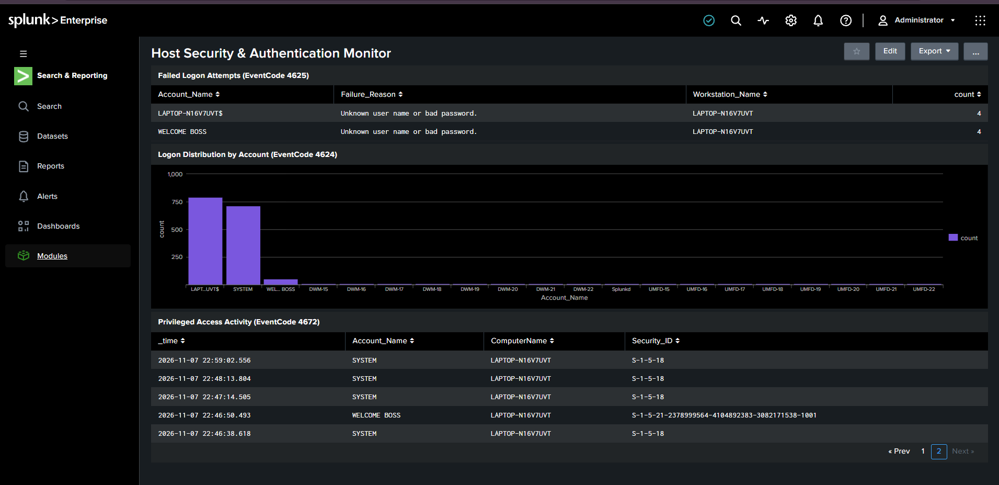

# Enterprise Windows Security Event Monitoring & Triage with Splunk SIEM

# Enterprise Windows Security Event Monitoring & Triage with Splunk SIEM



## 📌 Project Overview
Built a local Security Operations Center (SOC) home lab using **Splunk Enterprise** to ingest, parse, and analyze Windows Event Logs for real-time authentication monitoring, privilege auditing, and threat detection.

## 🛠️ Architecture & Tools
- **SIEM Platform:** Splunk Enterprise (Local Instance)
- **Log Source:** Windows Event Logs (`Security`, `System`)
- **Query Language:** Splunk Processing Language (SPL)
- **Role Simulation:** Tier 1 (L1) SOC Incident Response & Monitoring

---

## 🔍 Key Detection Scenarios & SPL Queries

### 1. User Authentication Baseline Audit (EventCode: 4624)
- **Objective:** Track successful interactive and network authentications across the host to establish normal baseline behavior.
- **SPL Query:**
  ```spl
  index=* sourcetype="WinEventLog:Security" EventCode=4624 
  | stats count by Account_Name, Logon_Type 
  | sort - count